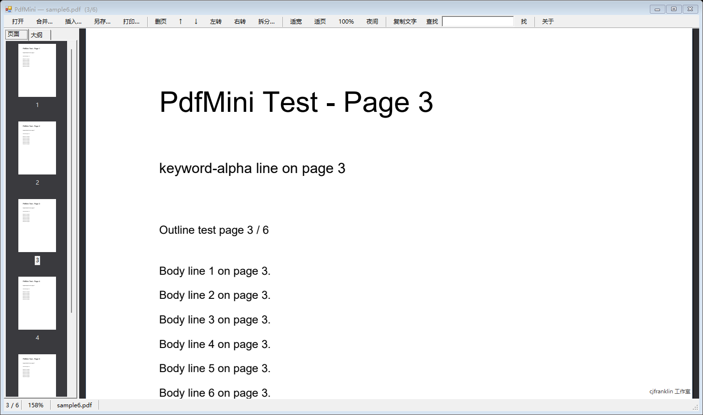
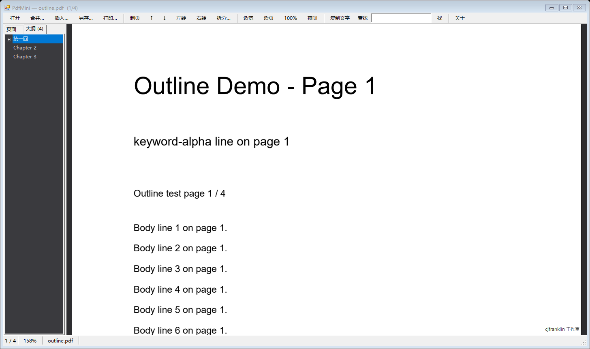
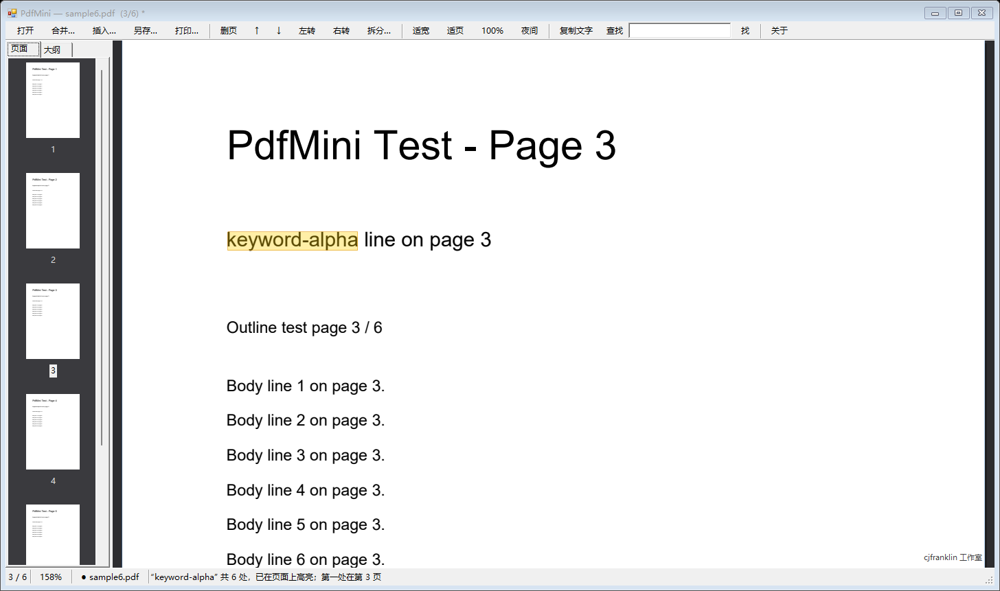
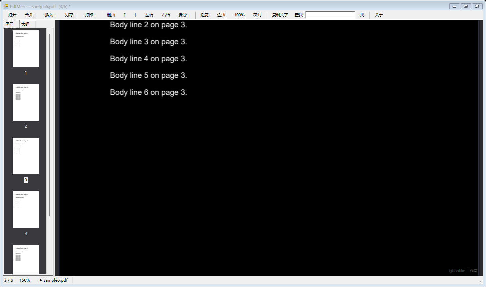

# PdfMini — 极简 PDF 阅读器（阅读 + 拆页/合并）

Windows 单文件小工具。做两件事：**舒服地读 PDF**，**顺手拆页/合并**。
不装运行库、不写注册表、不联网、不改原文件。



## 界面

| 大纲面板（PDF 书签，点即跳页） | 搜索高亮（黄色块精确压在命中文字上） |
|---|---|
|  |  |

| 夜间模式 | 连续滚动 |
|---|---|
|  | 整份文档纵向排布，滚到底自动接下一页 |

## 怎么跑

直接双击 `dist\PdfMini.exe`，或者把 PDF 拖到 exe / 窗口里。

> `PdfMini.exe` 和 `pdfium.dll` **必须放在同一目录**，复制走的时候整个 `dist` 一起拷。

### 从源码自己构建（克隆后三步）

```bat
powershell -ExecutionPolicy Bypass -File tools\fetch-pdfium.ps1   :: 下载 pdfium.dll（7.2MB，不入库）
build.cmd                                                          :: 用系统自带 csc.exe 编译出 dist\PdfMini.exe
build-uitest.cmd && dist\UiTest.exe test\sample6.pdf test "" test\outline.pdf   :: 可选：52 项无头断言
```

依赖只有 Windows 10/11 自带的 .NET Framework 4.8（`csc.exe`），**不需要安装 SDK**。
第三方组件与许可证见 [NOTICE.md](NOTICE.md)。

## 体积与内存（实测）

| 项 | 数值 |
|---|---|
| PdfMini.exe | 约 66 KB（含图标、版本信息、工作室署名） |
| pdfium.dll（渲染引擎） | 7.2 MB |
| **合计占用磁盘** | **约 7.3 MB**，零安装 |
| 打开 32 页图文 PDF（连续滚动 + 缩略图） | 峰值约 97 MB |
| 依赖 | 无（.NET Framework 4.8 是 Win10/11 自带） |

出品：**cjfranklin 工作室**（阅读区右下角有极淡的水印；工具栏「关于」可看版本与引擎授权）

## 功能

**阅读**
- **连续滚动**：整份文档纵向排布，滚到底自动接下一页；只缓存 4 页位图，其余按需补渲（不卡界面）
- 左侧「页面 / 大纲」双标签：页面缩略图（多选）+ PDF 书签大纲（点即跳页，删页后自动重映射）
- 适应宽度 / 适应整页 / 100% / 滚轮缩放（Ctrl+滚轮）
- 夜间反色（黑底白字，缩略图保持原样）
- **全文查找 + 页面高亮**：命中处直接画黄色高亮（跨行文字按行拆分），再按一次回车/「找」跳到下一个命中页；Esc 清除高亮
- 复制当前页全部文字（扫描件会提示“没有文字层”）
- **打印（Ctrl+P）**：所见即所得，300dpi 分条带渲染，峰值内存只多 10MB 左右
- 记住每份文件上次读到第几页（存在 `%APPDATA%\PdfMini\state.txt`）
- 加密 PDF 会弹密码框
- 拖放打开、DPI 感知（150% 缩放不糊）
- 阅读区右下角「cjfranklin 工作室」小水印（压在页面上时自动变极淡，不挡正文）
- 「关于」窗：工作室、版本、引擎授权；exe 右键属性里也能看到工作室署名

**编辑页面（全部只作用于“另存”的新文件）**
- 删除页 / 上移下移 / 左转右转 90°
- **拆分**：选中若干页 → 导出为新 PDF
- **合并**：把别的 PDF 追加到末尾
- **插入**：把别的 PDF 插到当前页之后
- 另存为；若目标就是原文件，会先留一份 `*.pdf.bak` 再覆盖

**快捷键**：`Ctrl+O` 打开 · `Ctrl+S` 另存 · `Ctrl+P` 打印 · `Ctrl+F` 查找 · `Ctrl+C` 复制本页文字 ·
`Ctrl+↑/↓` 上移下移页 · `Delete` 删页 · `PgUp/PgDn` 上下翻屏 · `Home/End` 首末页 · `+/-` 缩放 · `Esc` 清除高亮

## 设计原则

1. **永不原地改文件**：所有页面操作只改内存里的“页序表”，保存时按顺序导入新文档。
2. **页面引用模型**：会话 = 若干源文档 + 一张 `(源文档, 页号, 额外旋转)` 列表，所以删/移/插入/合并都是纯列表操作，保存时才真正写 PDF。
3. **渲染直连**：`FPDFBitmap_CreateEx` 把 pdfium 输出直接绑到托管 `Bitmap` 的扫描行，零拷贝。
4. **连续滚动靠“取页接口”解耦**：`IPageSource`（页数 / 页尺寸 / 按比例渲染）由 MainForm 实现，
   PageView 只管布局、滚动、缓存与绘制；缓存上限 4 页，渲染泵一次只渲一页，预取只做一张就停泵。

## 目录

```
pdfmini/
├─ src/            PdfApi.cs(pdfium封装) Session.cs(页序模型) PageView.cs MainForm.cs
│                  AboutForm.cs(关于窗) AssemblyInfo.cs(版本/工作室署名) Program.cs
├─ assets/         app.ico（7 个尺寸：16/24/32/48/64/128/256）+ 预览图
├─ dist/           PdfMini.exe + pdfium.dll  ← 发布物，就这两个文件
├─ vendor/         pdfium-binaries(chromium/8111, win-x64) 原始包 + 头文件 + LICENSE
├─ test/           sample6.pdf / extra3.pdf 测试素材, EngineTest.cs, UiTest.cs, 离屏快照
├─ tools/          make-icon.ps1（程序化生成图标）
└─ build.cmd       重新编译（用系统自带 csc.exe，不需要装 SDK）
```

## 重新编译

```
build.cmd            → dist\PdfMini.exe
build-test.cmd       → 引擎自检 EngineTest.exe（读/渲染/文字/导入/旋转/保存回读）
build-uitest.cmd     → 无头 UI 测试 UiTest.exe（窗体放屏幕外，反射调用真实业务方法）
tools\fetch-pdfium.ps1 → 下载 pdfium.dll（构建/运行前必做）
tools\make-icon.ps1    → 重新生成 assets\app.ico（改图标设计就改这个脚本）
tools\make-test-pdf.py → 生成测试素材（sample6 / extra3 / 带书签的 outline）
```

引擎自检：`EngineTest.exe test\sample6.pdf test\extra3.pdf test\out.pdf`
无头 UI 测试：`UiTest.exe test\sample6.pdf test "" test\outline.pdf`
（第 3 个参数可选：再传一份真实中文 PDF 路径做实战校验）
→ **52 项断言**：连续滚动（跳页/滚动/缓存上限）、适宽/适页/100%/旋转、夜间、水印、搜索高亮（含旋转后坐标）、
重复查找跳下一个、打印（打到 Microsoft Print to PDF 再回读页数/纸张/内容）、删页+旋转保存、拆分、大纲、真实中文 PDF
→ 另出 `ui_*.png` 快照（离屏 `DrawToBitmap`，不弹窗、不打扰桌面）

## 已知限制

- 不支持双页跨页、扫描件 OCR、矩形选区复制
- 连续滚动统一按“最宽页”计算缩放，混排版面（一页 A4 一页 A3）时窄页会偏窄
- 大纲只读第一份源文档的书签（合并进来的文档大纲不显示）
- 单页渲染上限 5000px（防爆内存），超级大页会略糊
- 用系统级 DPI 感知；多显示器不同缩放切换时不重新布局

## 许可

- 本项目源码：**MIT** — 见 [LICENSE](LICENSE)
- PDF 渲染引擎 **pdfium**：**BSD-3-Clause**（The PDFium Authors）
- 预编译构件来自 **pdfium-binaries**：**MIT**（Benoit Blanchon）
- 第三方许可证全文与声明见 [NOTICE.md](NOTICE.md) / [third_party/](third_party/)
